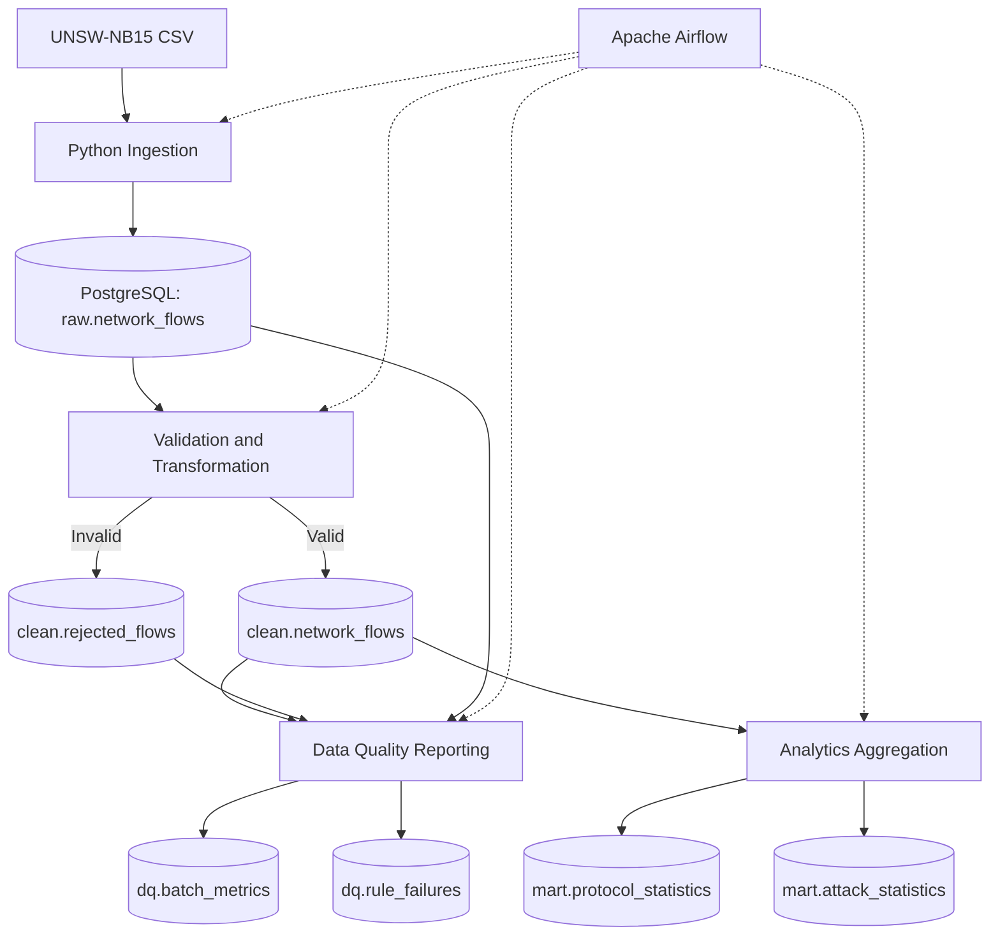

# Network Traffic Data Quality Pipeline

An end-to-end ETL pipeline for ingesting, validating, transforming, and analyzing network traffic data using Python, PostgreSQL, Docker, and Apache Airflow.

The project focuses on **data quality, reproducibility, idempotent processing, and failure recovery**, providing a structured foundation for downstream network traffic analysis and machine learning.

## Overview

Network traffic datasets contain heterogeneous features, including protocol identifiers, connection durations, packet counts, transferred bytes, and attack classifications. Before such data can be used reliably for analysis or machine learning, it must be validated, cleaned, and organized.

This project implements a multistage data pipeline that:

- Ingests CSV records into PostgreSQL without requiring immediate type conversion.
- Identifies ingestion batches using deterministic file hashes.
- Validates records against configurable data quality rules implemented in Python.
- Separates valid records from rejected records while preserving rejection reasons.
- Generates batch-level data quality metrics and rule-failure reports.
- Builds analytical tables containing protocol and attack-category statistics.
- Orchestrates processing stages with Apache Airflow.
- Supports safe re-execution and recovery from partially completed ingestion.
- Provides automated tests and reproducible database initialization.

The pipeline uses the **UNSW-NB15 training dataset**, containing 175,341 network traffic records.

## Architecture



The pipeline follows a layered data architecture:

| Layer | Purpose |
|---|---|
| RAW | Preserve original CSV records as JSONB |
| CLEAN | Store validated records with typed columns |
| REJECTED | Preserve invalid records and their rejection reasons |
| DQ | Track data quality metrics and validation failures |
| MART | Provide aggregated data for analysis |

Airflow manages task execution, dependencies, retries, and monitoring. The processing logic remains independent of the orchestration framework.

## Technology Stack

| Technology | Purpose |
|---|---|
| Python 3.10 | Ingestion, validation, transformation, reporting |
| PostgreSQL 16 | Data storage, constraints, analytical queries |
| Psycopg 3 | PostgreSQL connectivity |
| Docker Compose | PostgreSQL container management |
| Apache Airflow 3.3.2 | Workflow orchestration and monitoring |
| pytest | Unit and integration testing |
| Bash | Database initialization and smoke testing |
| Git | Version control |

## Project Structure

```text
network-traffic-dq/
├── dags/
│   ├── network_traffic_pipeline.py
│   └── retry_test.py
├── data/
│   ├── raw/
│   └── broken/
├── pipeline/
│   ├── load.py
│   ├── validate.py
│   ├── transform.py
│   ├── quality.py
│   ├── mart.py
│   └── generate_broken.py
├── scripts/
│   ├── init_db.sh
│   └── smoke_test.sh
├── sql/
│   ├── 01_raw_tables.sql
│   ├── 02_clean_tables.sql
│   ├── 03_data_quality.sql
│   └── 04_mart_tables.sql
├── tests/
│   ├── test_validate.py
│   └── test_pipeline_integration.py
├── compose.yaml
├── pytest.ini
├── requirements.txt
├── requirements-airflow.txt
└── README.md
```

Dataset files, local environments, credentials, and Airflow runtime data are excluded from version control.

## Data Processing

### 1. Ingestion

The ingestion stage reads CSV records and stores them in `raw.network_flows`.

Original records are preserved as PostgreSQL `JSONB`, allowing ingestion without immediate conversion to typed database columns.

Each source file receives a deterministic batch identifier generated using:

1. SHA-256 hashing of the file contents.
2. UUID5 generation from the resulting checksum.

Individual records are identified by their batch ID and source row number.

A unique database constraint, combined with `ON CONFLICT DO NOTHING`, prevents duplicate ingestion when processing the same file repeatedly.

Records are inserted in batches of 1,000, with transactions committed between batches.

### 2. Validation and Transformation

The transformation stage reads raw records and validates selected fields before inserting them into typed tables.

Implemented validation includes:

- Required-field checks.
- Integer and floating-point parsing.
- Numeric range and sign validation.
- Rejection of non-finite numeric values.
- Integer overflow checks.
- Binary label validation (`0` or `1`).

Valid records are written to `clean.network_flows`.

Invalid records are written to `clean.rejected_flows`, including the validation failures associated with each record.

Rejected records remain linked to their original raw records, allowing inspection and troubleshooting without losing the source data.

### 3. Data Quality Reporting

The reporting stage generates metrics for each ingestion batch.

`dq.batch_metrics` contains:

- Total records.
- Valid records.
- Rejected records.
- Unprocessed records.
- Conflicting records.
- Rejection rate.

`dq.rule_failures` stores aggregated occurrences of individual validation failures.

These reports make it possible to distinguish the overall proportion of rejected records from the frequency of individual rule violations.

A single record may violate multiple validation rules.

### 4. Analytics MART

The MART layer aggregates validated traffic records.

**Protocol statistics** include:

- Protocol.
- Traffic label.
- Flow count.
- Total source bytes.
- Total destination bytes.
- Average connection duration.

**Attack statistics** include:

- Attack category.
- Flow count.

These tables provide compact analytical summaries without repeatedly scanning the full cleaned dataset.

## Dataset and Results

The pipeline uses the publicly available UNSW-NB15 dataset.

The training CSV contains **175,341 records**, including:

| Classification | Records |
|---|---:|
| Normal | 56,000 |
| Attack | 119,341 |
| Total | 175,341 |

### Original Dataset

The original training data produced the following results:

| Metric | Result |
|---|---:|
| RAW records | 175,341 |
| CLEAN records | 175,341 |
| Rejected records | 0 |
| Unprocessed records | 0 |
| Protocol MART flow count | 175,341 |
| Attack MART flow count | 175,341 |

All original records passed the validation rules implemented in this project.

**This does not imply that the dataset is error-free.** It indicates only that no violations were detected by the current validation rules.

### Deliberately Corrupted Data

To verify rejection handling, a separate eight-record fixture was generated from the original dataset.

Seven records contain deliberately introduced errors, including:

- Invalid numeric values.
- Negative connection durations.
- Negative byte counts.
- Invalid classification labels.
- Missing required values.
- Non-finite numeric values.

One record remains valid.

Results:

| Metric | Result |
|---|---:|
| Total records | 8 |
| Valid records | 1 |
| Rejected records | 7 |
| Rejection rate | 87.50% |
| Total rule violations | 9 |
| Distinct rejection reasons | 7 |

The experiment confirms that the implemented validation rules detect the introduced errors and preserve multiple rejection reasons when applicable.

The deliberately corrupted data is used for validation testing, not as evidence of the original dataset's quality.

### Dataset Integrity

The SHA-256 checksum of the training CSV used during development is:

```text
bec7dd5ec88dc2a0ccc7a07879d338395ed7421750f675fd0339e07dfe0648fa
```

Verify a downloaded dataset using:

```bash
sha256sum data/raw/UNSW_NB15_training-set.csv
```

The checksum supports reproducibility by identifying the exact source file used.

## Setup

### Prerequisites

- Python 3.10
- Docker and Docker Compose
- Git
- Bash
- Access to the UNSW-NB15 training CSV

### 1. Clone the Repository

```bash
git clone <https://github.com/Bekzhan-Kasymbekov/network-traffic-dq>
cd network-traffic-dq
```

### 2. Install Python Dependencies

Create the ETL virtual environment:

```bash
python3 -m venv .venv
source .venv/bin/activate

python -m pip install -r requirements.txt
```

### 3. Configure Environment Variables

Create a `.env` file containing the database configuration required by `compose.yaml`.

For the local development configuration:

```dotenv
POSTGRES_USER=pipeline_user
POSTGRES_PASSWORD=<your-password>
POSTGRES_DB=network_traffic

DATABASE_URL=postgresql://pipeline_user:<your-password>@127.0.0.1:5433/network_traffic
TEST_DATABASE_URL=postgresql://pipeline_user:<your-password>@127.0.0.1:5433/network_traffic_test
```

Replace `<your-password>` with a local development password.

The connection strings above assume Docker Compose publishes PostgreSQL on host port `5433`.

Do not commit `.env` or real credentials.

### 4. Start PostgreSQL

```bash
docker compose up -d
```

Check container status:

```bash
docker compose ps
```

### 5. Initialize the Database

The database initialization script creates the requested database if necessary and applies the SQL migration files in order.

```bash
./scripts/init_db.sh network_traffic
```

The script can also initialize separate databases:

```bash
./scripts/init_db.sh network_traffic_test
```

Existing databases are detected automatically.

The SQL scripts support repeated execution for the current schema, but the initialization script is not a versioned migration system.

### 6. Prepare the Dataset

Place the UNSW-NB15 training CSV at:

```text
data/raw/UNSW_NB15_training-set.csv
```

The dataset is not included in the repository.

## Running the Pipeline

Load database environment variables:

```bash
set -a
source .env
set +a
```

Execute each stage:

```bash
python -m pipeline.load
python -m pipeline.transform
python -m pipeline.quality
python -m pipeline.mart
```

The stages must execute in dependency order.

Ingestion must complete before transformation. Data quality reporting and MART generation can run after transformation.

## Airflow Orchestration

Apache Airflow provides a graphical interface for managing and monitoring pipeline execution.

The DAG is defined in:

```text
dags/network_traffic_pipeline.py
```

Its dependencies are:

```text
load_raw
    |
    v
transform
    |
    +------------+
    |            |
    v            v
quality       build_mart
```

The DAG uses:

- Manual triggering.
- One retry per failed task.
- A one-minute retry delay.
- A maximum of one active DAG run.
- Independent quality-reporting and MART tasks.

### Install Airflow

Airflow is installed in a separate virtual environment to isolate its dependencies from the ETL application.

```bash
python3 -m venv .venv-airflow
source .venv-airflow/bin/activate
```

Install Airflow using its version-specific constraints:

```bash
python -m pip install -r requirements-airflow.txt \
  --constraint \
  "https://raw.githubusercontent.com/apache/airflow/constraints-3.3.2/constraints-3.10.txt"
```

### Start Airflow

From the project root:

```bash
set -a
source .env
set +a

export AIRFLOW_HOME="$PWD/.airflow"
export AIRFLOW__CORE__DAGS_FOLDER="$PWD/dags"
export AIRFLOW__CORE__LOAD_EXAMPLES=False

airflow standalone
```

Open the web interface at:

```text
http://localhost:8080
```

The DAG can be triggered manually from the Airflow interface.

Airflow uses the ETL application's `.venv/bin/python` interpreter to execute the existing processing modules through subprocesses.

This allows the ETL logic to run independently from Airflow while preserving centralized orchestration and logging.

The standalone configuration is intended for local development and demonstration.

## Testing

The project includes unit tests, integration tests, and end-to-end verification.

### Unit and Integration Tests

Initialize the test database:

```bash
./scripts/init_db.sh network_traffic_test
```

Activate the ETL environment and load configuration:

```bash
source .venv/bin/activate

set -a
source .env
set +a
```

Run the tests:

```bash
python -m pytest -v
```

The test suite verifies:

- Validation of malformed and invalid records.
- Separation of valid and rejected records.
- Preservation of multiple rejection reasons.
- Idempotent ingestion and transformation.
- Correct data quality metrics.
- Correct MART aggregation.
- Recovery from partially completed ingestion.

The integration tests use a dedicated PostgreSQL test database and reset their test tables.

### End-to-End Smoke Test

The smoke-test script initializes an isolated database, executes all four pipeline stages, and verifies the results.

```bash
./scripts/smoke_test.sh
```

The expected output includes:

```text
RAW records:      175341
CLEAN records:    175341
REJECTED records: 0
Protocol flows:   175341
Attack flows:     175341
Valid DQ reports: 1

Smoke test PASSED.
```

The script exits with a nonzero status if initialization, processing, or verification fails.

Running the smoke test repeatedly also verifies that the pipeline does not duplicate previously processed records.

### Failure Recovery

The project includes two recovery experiments.

**Partial ingestion recovery**

The integration test simulates a database containing only a committed subset of an ingestion batch.

The loader is executed again and must insert the remaining records without duplicating existing ones.

**Airflow retry recovery**

A dedicated Airflow DAG, `retry_test`, deliberately fails its first task attempt and succeeds on retry.

This verifies task failure detection, retry scheduling, and successful recovery in the local Airflow environment.

## Engineering Decisions

### Preserving Original Data

The RAW layer stores complete source records as JSONB instead of immediately converting fields into typed columns.

This prevents malformed values from being silently discarded during ingestion and allows validation rules to evolve independently of the source data.

### Deterministic Batch Identification

Batch IDs are derived from file contents rather than generated randomly during execution.

This makes ingestion reproducible and supports safe retries.

### Idempotent Processing

Database uniqueness constraints and conflict-handling strategies prevent duplicate records during repeated executions.

Reporting and MART generation are designed to produce consistent results when rerun against unchanged source data.

### Separating Orchestration and Processing

Airflow coordinates task execution but does not contain the ETL business logic.

The pipeline modules can also be executed independently from the command line, simplifying development, testing, and troubleshooting.

### Preserving Validation Failures

Invalid records are stored separately with their rejection reasons instead of being silently dropped.

This provides traceability and makes the validation process inspectable.

## Limitations and Future Improvements

The current implementation is designed for local development and reproducible experimentation rather than production deployment.

Potential improvements include:

- Incremental transformation and MART updates instead of full refreshes.
- Automated schema migration versioning.
- More extensive validation rules and cross-field consistency checks.
- Dataset schema versioning and schema-drift detection.
- Dedicated monitoring and alerting for failed or delayed pipeline runs.
- Improved secrets management through Airflow Connections or an external secrets manager.
- Containerized deployment of the complete application stack.
- Automated CI testing.
- Performance benchmarking on larger datasets.

The current pipeline also validates a selected subset of the available UNSW-NB15 features rather than transforming every source column into its own typed database field.

## Project Context

This project was developed as a practical exercise in data engineering, focusing on the design and implementation of a reproducible ETL pipeline.

It also provides a foundation for further work involving network traffic analysis, data preprocessing, feature selection, and machine learning-based intrusion detection.
